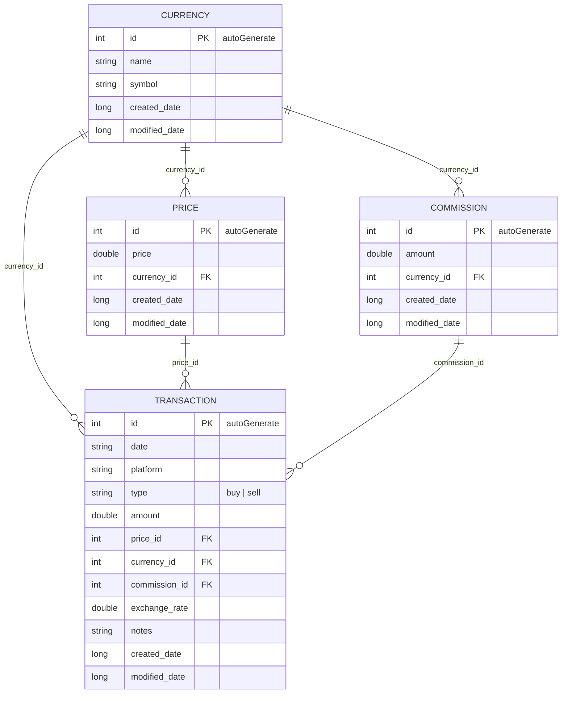

# Entity Relationship Diagram — CryptoTracker

Room database: `TrackerDatabase` (version 1). All foreign keys are **logical only** —
entities declare no `@ForeignKey` or `@Index` annotations, so referential integrity
is not enforced at the SQLite level.

All relationships are one-to-many, expressed both as an FK column on the child and
as a navigation property (`@Relation` POJOs: `CurrencyWithPrices`, `CurrencyWithCommissions`,
`CurrencyWithTransactions`, `PriceWithTransactions`, `CommissionWithTransactions`).

## Source entities

| Entity | Table | File |
|---|---|---|
| `Currency` | `currency` | `app/src/main/java/io/github/santiago120600/cryptotracker/data/local/entity/Currency.kt` |
| `Price` | `price` | `app/src/main/java/io/github/santiago120600/cryptotracker/data/local/entity/Price.kt` |
| `Commission` | `commission` | `app/src/main/java/io/github/santiago120600/cryptotracker/data/local/entity/Commission.kt` |
| `Transaction` | `money_transaction` | `app/src/main/java/io/github/santiago120600/cryptotracker/data/local/entity/Transaction.kt` |
